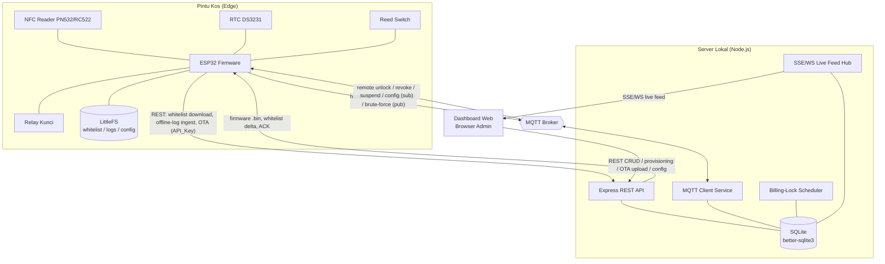
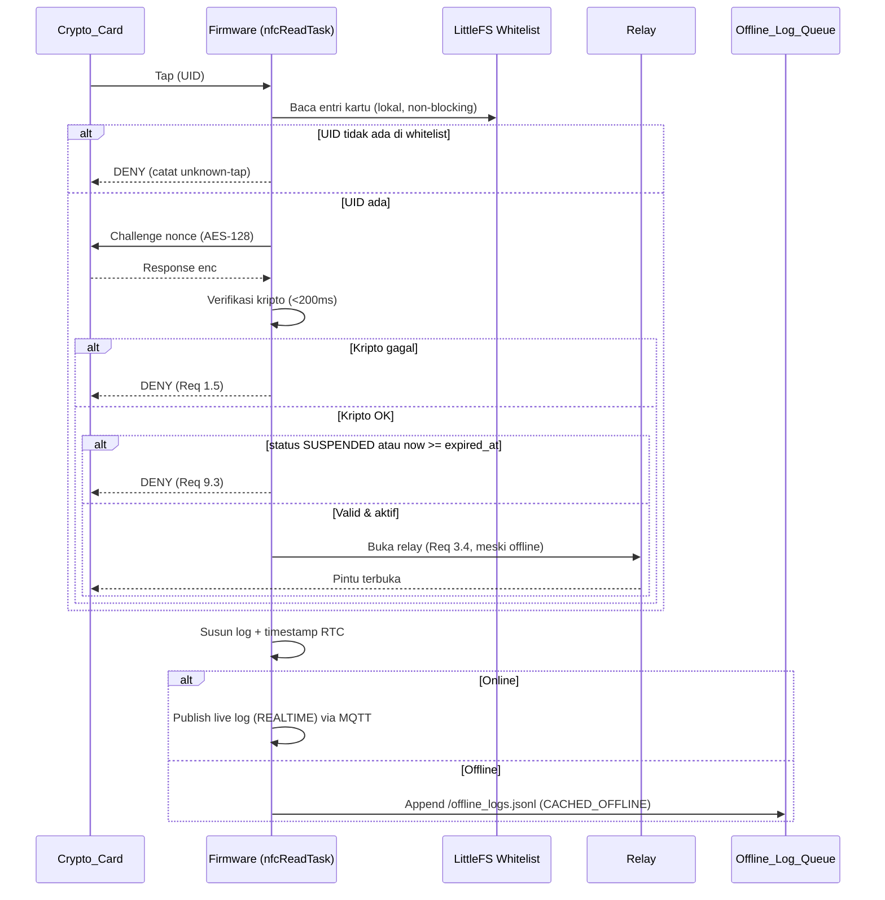
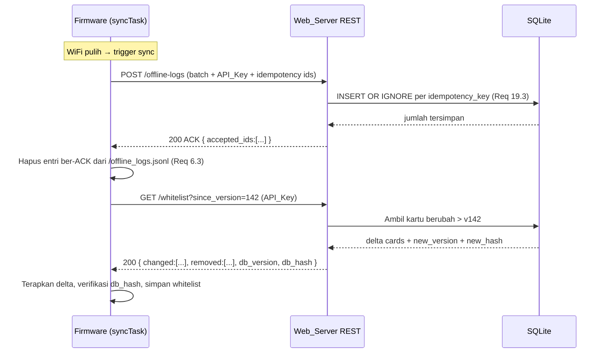
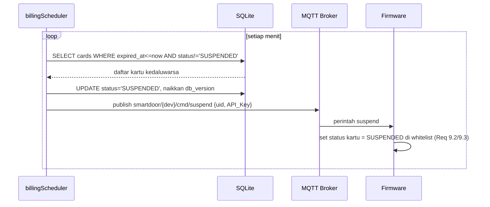
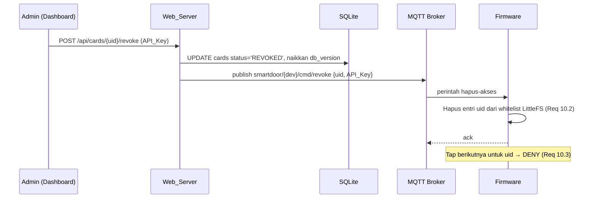
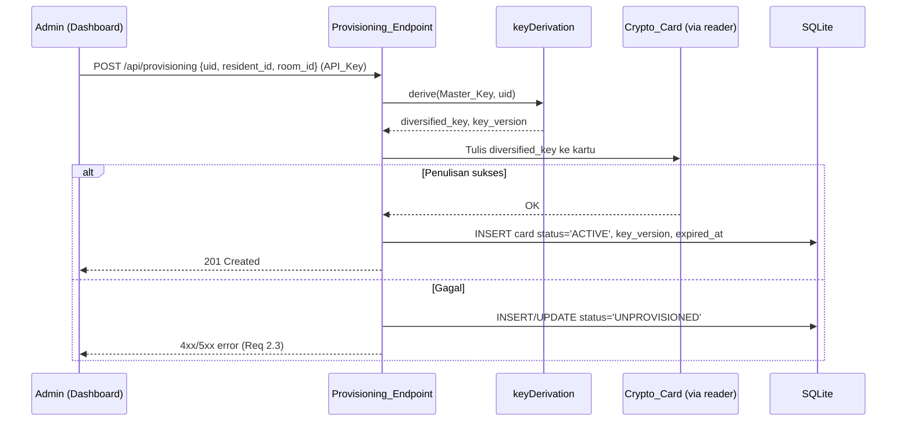
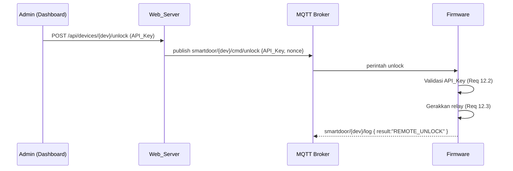
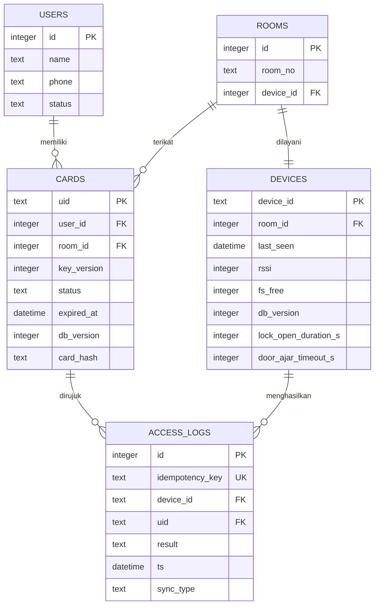

# Dokumen Desain — Smart Door KOS ESP32

## Overview

Smart Door KOS adalah sistem kontrol akses pintu kos berbasis kartu NFC kripto dengan dua target yang bekerja sama:

- **TARGET 1 — Firmware ESP32 (C++/Arduino):** pengambil keputusan lokal (edge) yang bersifat *offline-first*. Membaca kartu kripto, memverifikasi secara kriptografis (<200 ms), menggerakkan relay, mencatat log, dan menyinkronkan data secara non-blocking.
- **TARGET 2 — Web Server & Dashboard (Node.js):** pusat manajemen residen/kamar/kartu, provisioning kartu, penjadwalan billing-lock, pencabutan instan, pemantauan kesehatan, remote unlock, alert tamper, live feed, audit trail, OTA, dan konfigurasi pintu.

Arsitektur mengikuti prinsip **keputusan di edge, koordinasi di cloud lokal**: pintu selalu dapat beroperasi meski server/WiFi mati. Server menjadi *source of truth* untuk data kartu dan menerima log; firmware menjadi *source of truth* untuk keputusan real-time.

### Keputusan Teknologi (sesuai asumsi requirements)

| Area | Pilihan | Alasan |
|------|---------|--------|
| HTTP framework | **Express** | Ringan, ekosistem matang, CommonJS |
| Basis data | **better-sqlite3** | Akses sinkron, cocok beban lokal, transaksi mudah |
| Messaging | **mqtt v5.x** (sudah di `package.json`) | Perintah real-time ringan (heartbeat, unlock, event) |
| Live feed | **SSE** (default) dengan opsi WebSocket | Satu arah server→dashboard, cukup untuk feed |
| Module system | **CommonJS** | Sesuai `package.json` eksisting |
| NFC reader | **PN532 / RC522** | Mendukung DESFire & NTAG 424 DNA |
| Kartu | **DESFire EV2/EV3** atau **NTAG 424 DNA** | AES-128 challenge-response / encrypted file read |
| RTC | **DS3231** | Timestamp akurat offline |
| Flash storage | **LittleFS** | Whitelist, antrean log, config |

---

## Architecture

### Diagram Komponen



### Pemisahan Tanggung Jawab

- **Transport layer** (MQTT client, Express router) terpisah dari **domain logic** (verifikasi, scheduler, derivasi kunci) agar mudah diuji dan diubah.
- **Firmware** memisahkan akuisisi NFC, keputusan akses, I/O LittleFS, dan networking ke task/modul berbeda.

---

## Components and Interfaces

### TARGET 1 — Desain Firmware ESP32

#### Model Penjadwalan Non-Blocking (RULE B, Req 18)

Firmware menggunakan **FreeRTOS tasks** untuk isolasi, dengan `millis()`-based scheduling di dalam task sebagai cadangan. Tidak ada `delay()` di jalur kritis. Loop verifikasi kartu berjalan pada task prioritas tertinggi agar tetap <200 ms meski networking sibuk.

| Task | Prioritas | Periode/Trigger | Tanggung jawab |
|------|-----------|-----------------|----------------|
| `nfcReadTask` | Tertinggi | event (polling 50 ms) | Deteksi kartu, verifikasi kripto, putuskan GRANT/DENY, picu relay, enqueue log |
| `doorControlTask` | Tinggi | millis() | Timer `Lock_Open_Duration`, deteksi door-ajar via reed switch, alarm, deteksi tamper |
| `wifiTask` | Sedang | millis() (backoff) | Rekoneksi WiFi non-blocking, cek RSSI |
| `mqttTask` | Sedang | event + keep-alive | Heartbeat, publish live log/event, subscribe perintah |
| `syncTask` | Rendah | saat WiFi pulih | Push offline logs, terima ACK, pull card delta, OTA |
| `timeTask` | Rendah | periodik (jam) | Sinkron RTC↔NTP saat online |
| `watchdogFeed` | — | di tiap task | Feed Task Watchdog Timer (TWDT) |

**Aturan kunci:**
- `nfcReadTask` **tidak pernah** menunggu jaringan (Req 3.3). Keputusan murni dari LittleFS.
- `wifiTask` memakai state machine `DISCONNECTED → CONNECTING → CONNECTED` dengan *exponential backoff*; kegagalan WiFi tidak memblok verifikasi (Req 18.2).
- Setiap task memanggil `esp_task_wdt_reset()`; TWDT dikonfigurasi me-restart controller bila ada task hang (Req 18.4, 18.5).
- Parsing JSON memakai `ArduinoJson` dengan ukuran dokumen terukur / `StaticJsonDocument` berbatas untuk mencegah gagal alokasi heap (Req 18.3).

```cpp
// Sketsa struktur loop non-blocking di dalam doorControlTask
void doorControlTask(void* pv) {
  for (;;) {
    uint32_t now = millis();
    if (relayOpen && now - relayOpenedAt >= cfg.lockOpenDurationMs) {
      closeRelay();                      // tutup setelah durasi
    }
    if (doorIsOpen() && now - doorOpenedAt >= cfg.doorAjarTimeoutMs) {
      raiseDoorAjarAlarm();              // Req 17.4
    }
    if (doorIsOpen() && !relayWasEngaged(now)) {
      enqueueTamperEvent();              // Req 13.2 forced open tanpa relay
    }
    esp_task_wdt_reset();
    vTaskDelay(pdMS_TO_TICKS(20));       // yield, bukan blocking delay()
  }
}
```

#### Lapisan Verifikasi NFC Kripto (RULE A, Req 1)

Firmware tidak mempercayai UID sebagai bukti. Verifikasi memakai salah satu skema (dipilih sesuai tipe kartu):

**Skema A — AES-128 Challenge-Response (DESFire):**
1. Baca UID kartu.
2. Ambil `diversified_key` kartu dari whitelist LittleFS (disimpan terenkripsi dengan kunci perangkat).
3. Firmware/reader kirim nonce acak (challenge) ke kartu; kartu balas `enc = AES-128(nonce, diversified_key)`.
4. Firmware verifikasi `AES-128_decrypt(enc, diversified_key) == nonce` (mutual auth).
5. Jika cocok → lanjut cek status; jika tidak → DENY, relay diam (Req 1.5).

**Skema B — Encrypted File Read (NTAG 424 DNA):**
1. Baca UID.
2. Autentikasi sesi AES dengan `diversified_key`, baca berkas terenkripsi berisi secret kartu.
3. Bandingkan secret dengan nilai referensi di whitelist.

**Derivasi Diversified Key** (konsisten dengan server, Req 1.4/2.2):
```
diversified_key = CMAC-AES128(Master_Key, UID || label_konstanta)
```
Master_Key **tidak pernah** disimpan di firmware. Firmware hanya menyimpan `diversified_key` per kartu (atau parameter yang diperlukan) dalam whitelist terenkripsi. Derivasi penuh dilakukan server saat provisioning dan saat membangun whitelist.

#### Tata Letak LittleFS

```
/whitelist.json        # daftar kartu valid + status + expired_at + versi/hash DB
/offline_logs.jsonl    # antrean log (satu JSON per baris)
/config.json           # parameter pintu + jaringan
/device.key            # kunci enkripsi lokal untuk melindungi diversified_key (di NVS terenkripsi lebih disukai)
```

**`whitelist.json`:**
```json
{
  "db_version": 142,
  "db_hash": "sha256:a3f1...",
  "cards": [
    {
      "uid": "04A2B3C4D5",
      "key_version": 3,
      "key_params": "base64(enc(diversified_key))",
      "status": "ACTIVE",
      "expired_at": "2025-07-01T00:00:00Z"
    }
  ]
}
```
- `status` ∈ `ACTIVE | SUSPENDED`. Kartu dicabut dihapus total dari array (Req 10).
- `db_version` (monotonik) + `db_hash` menjadi dasar Delta_Sync (Req 4.3).

**`offline_logs.jsonl`** (append-only, satu baris per kejadian — tahan korupsi parsial):
```json
{"id":"dev01-000017","ts":"2025-06-18T09:12:03Z","uid":"04A2B3C4D5","result":"GRANT","sync_type":"CACHED_OFFLINE"}
```
`id` = idempotency key = `deviceId + "-" + counterMonotonikPersisten`.

**`config.json`:**
```json
{
  "lock_open_duration_s": 5,
  "door_ajar_timeout_s": 30,
  "api_key": "…",
  "mqtt": { "host": "192.168.1.10", "port": 1883, "base_topic": "smartdoor" },
  "whitelist_url": "http://192.168.1.10:3000/api/devices/dev01/whitelist"
}
```

#### Strategi Waktu: RTC DS3231 + NTP (Req 5)

- RTC DS3231 menjadi sumber waktu utama untuk timestamp log → akurat meski offline dan setelah power loss (Req 5.4).
- `timeTask` menyinkronkan RTC dari NTP saat online (`WHILE online`, Req 5.3), lalu RTC mempertahankan waktu dengan baterai cadangannya.
- Semua timestamp ditulis ISO-8601 UTC.

#### Alur Keputusan Offline-First (Req 3)



#### Alur Delta Sync saat Pemulihan WiFi (Req 6)



#### Deteksi Tamper & Brute-Force (Req 13)

- **Brute-force:** `nfcReadTask` menjaga penghitung tap kartu tak dikenal berturut-turut. Tap valid (dikenal) mereset penghitung ke 0. Saat penghitung **> 3**, publish event `brute_force` ke MQTT.
- **Tamper:** `doorControlTask` memantau reed switch. Jika pintu beralih ke *open* sementara relay **tidak** diaktifkan dalam jendela waktu wajar → publish event `tamper` (forced open).
- Saat offline, event juga di-enqueue agar tidak hilang.

---

### TARGET 2 — Desain Web Server & Dashboard (Node.js)

#### Struktur Modul (CommonJS)

```
/src
  app.js                 # bootstrap Express + MQTT + scheduler + SSE hub
  db/
    index.js             # koneksi better-sqlite3 + migrasi
    schema.sql           # DDL tabel
  middleware/
    apiKey.js            # autentikasi API_Key (Req 7.3/7.4)
  routes/
    residents.js         # CRUD resident (Req 8.1)
    rooms.js             # CRUD room (Req 8.2)
    cards.js             # CRUD + bind kartu↔resident↔room (Req 8.3)
    provisioning.js      # provisioning + derivasi kunci (Req 2)
    whitelist.js         # download whitelist + delta (Req 4.3, 7.2)
    offlineLogs.js       # ingest idempoten (Req 6.4, 19.2)
    ota.js               # upload .bin + delivery (Req 16)
    config.js            # parameter pintu (Req 17)
    revoke.js            # pencabutan/blacklist instan (Req 10)
  services/
    keyDerivation.js     # Diversified_Key = f(Master_Key, UID)
    mqttService.js       # heartbeat consumer, event consumer, publisher perintah
    billingScheduler.js  # expired_at → Suspended → sync (Req 9)
    deviceHealth.js      # status online/offline, RSSI, LittleFS, db_version (Req 11)
    liveFeed.js          # SSE/WS hub (Req 14)
    auditTrail.js        # simpan access_logs + sync_type (Req 15)
    whitelistVersion.js  # versioning/hash untuk delta (Req 4.3)
  public/                # dashboard statis
```

#### Billing-Lock Scheduler (Req 9)

Job periodik (mis. tiap menit) memindai `cards` dengan `expired_at <= now()` dan `status != 'SUSPENDED'`, menetapkan `status = 'SUSPENDED'`, menaikkan `db_version`, lalu mempublish perintah suspend ke firmware via MQTT dan menandai whitelist untuk delta sync berikutnya.



#### Pencabutan & Blacklist Instan (Req 10)



#### Provisioning Kartu + Derivasi Kunci (Req 2)



#### Device Health (Req 11)

- `mqttService` mengonsumsi topik heartbeat; menyimpan `last_seen`, `rssi`, `fs_free`, `db_version` per device.
- `deviceHealth` menghitung status **Offline** bila `now - last_seen > heartbeat_interval` yang dikonfigurasi (Req 11.4). Dashboard menampilkan RSSI, ruang LittleFS kosong, dan versi DB lokal (Req 11.3).

#### Remote Unlock (Req 12)



#### Live Access Feed & Audit Trail (Req 14, 15)

- Setiap log masuk (via MQTT live atau via ingest offline) ditulis ke `access_logs` dengan `sync_type`:
  - Diterima langsung saat online → `REALTIME` (Req 15.2).
  - Diterima dari antrean offline saat sync → `CACHED_OFFLINE` (Req 15.3).
- `liveFeed` mem-broadcast event ke klien dashboard melalui **SSE** (`text/event-stream`), dengan opsi WebSocket untuk kebutuhan dua arah.

#### Web OTA Update (Req 16)

- Dashboard mengunggah `.bin` → `ota.js` menyimpan berkas + checksum (SHA-256).
- Server mengirim firmware ke device via HTTP REST (push perintah OTA via MQTT dengan URL unduhan + API_Key, firmware menarik `.bin`).
- Firmware memverifikasi checksum/validitas; bila gagal, membatalkan dan tetap menjalankan firmware lama (Req 16.3).

#### REST API Endpoint

| Method | Path | Auth | Tujuan | Req |
|--------|------|------|--------|-----|
| POST | `/api/provisioning` | API_Key | Provisioning kartu + derivasi kunci | 2 |
| GET | `/api/devices/:dev/whitelist` | API_Key | Unduh whitelist penuh | 4, 7.2 |
| GET | `/api/devices/:dev/whitelist?since_version=N` | API_Key | Delta whitelist (versi/hash) | 4.3 |
| POST | `/api/devices/:dev/offline-logs` | API_Key | Ingest log offline **idempoten** | 6.4, 19.2 |
| POST | `/api/devices/:dev/unlock` | API_Key | Remote unlock (relay via MQTT) | 12 |
| POST | `/api/cards/:uid/revoke` | API_Key | Cabut akses instan | 10 |
| POST | `/api/devices/:dev/ota` | API_Key | Upload `.bin` & jadwalkan OTA | 16 |
| PUT | `/api/devices/:dev/config` | API_Key | Set `lock_open_duration`, `door_ajar_timeout` | 17 |
| CRUD | `/api/residents`, `/api/rooms`, `/api/cards` | API_Key | Manajemen entitas | 8 |
| GET | `/api/feed` (SSE) | session/API_Key | Live access feed | 14 |

#### Desain Topik MQTT

Base topic: `smartdoor`. `{dev}` = device id (satu ESP32 per pintu).

| Arah | Topik | Payload (ber-API_Key) | Req |
|------|-------|-----------------------|-----|
| Firmware→Server | `smartdoor/{dev}/heartbeat` | `{ rssi, fs_free, db_version, ts, api_key }` | 11.1 |
| Firmware→Server | `smartdoor/{dev}/log` | `{ uid, result, ts, sync_type:"REALTIME", api_key }` | 14 |
| Firmware→Server | `smartdoor/{dev}/event/tamper` | `{ ts, api_key }` | 13.2 |
| Firmware→Server | `smartdoor/{dev}/event/bruteforce` | `{ count, ts, api_key }` | 13.1 |
| Server→Firmware | `smartdoor/{dev}/cmd/unlock` | `{ nonce, api_key }` | 12.2 |
| Server→Firmware | `smartdoor/{dev}/cmd/revoke` | `{ uid, api_key }` | 10.1 |
| Server→Firmware | `smartdoor/{dev}/cmd/suspend` | `{ uid, api_key }` | 9.2 |
| Server→Firmware | `smartdoor/{dev}/cmd/config` | `{ lock_open_duration_s, door_ajar_timeout_s, api_key }` | 17.3 |

#### Autentikasi API_Key (Req 7)

- Middleware `apiKey.js` memeriksa header `X-API-Key` (atau field `api_key` payload) pada **setiap** request REST; menolak dengan `401` bila absen/salah (Req 7.4).
- Konsumer MQTT memvalidasi `api_key` di dalam setiap payload sebelum memproses; perintah tanpa API_Key valid diabaikan.

---

## Data Models

### Diagram Relasi



### Field Kunci & Aturan

- **`users`**: entitas resident (Req 8.1). `status` ∈ `ACTIVE | INACTIVE`.
- **`rooms`**: kamar (Req 8.2); satu kamar dilayani satu device.
- **`cards`**: `uid` (PK), `key_version` (mendukung rotasi kunci & delta), `status` ∈ `ACTIVE | SUSPENDED | REVOKED | UNPROVISIONED`, `expired_at` (Req 9.1), `card_hash` (SHA-256 isi relevan kartu) dan `db_version` untuk delta sync. Constraint `UNIQUE(uid)` + satu kartu terikat satu user & satu room (Req 8.3).
- **`devices`**: satu baris per ESP32/pintu; menyimpan telemetri kesehatan (Req 11) dan parameter pintu (Req 17).
- **`access_logs`**: `idempotency_key` **UNIQUE** (Req 19.3), `sync_type` ∈ `REALTIME | CACHED_OFFLINE` (Req 15).

### Versioning & Hash Kartu untuk Delta Sync (Req 4.3)

- Tiap device memiliki `db_version` monotonik. Setiap perubahan kartu (provisioning, suspend, revoke, update) menaikkan `db_version` device terkait dan memperbarui `card_hash` kartu.
- Snapshot whitelist memiliki `db_hash = SHA-256(daftar card_hash terurut)`.
- Firmware mengirim `since_version`; server mengembalikan kartu dengan `db_version > since_version` (changed) dan daftar `uid` yang dihapus/dicabut (removed), plus `db_version`/`db_hash` baru. Firmware memverifikasi `db_hash` setelah menerapkan delta untuk menjamin konsistensi.

### Desain Idempotency Key untuk Ingest Offline-Log (Req 6.4, 19)

- `idempotency_key = deviceId + "-" + counterMonotonikPersisten` (dibuat firmware, disimpan di `offline_logs.jsonl`).
- Counter persisten di NVS/LittleFS agar tetap unik lintas reboot.
- Server melakukan `INSERT ... ON CONFLICT(idempotency_key) DO NOTHING` sehingga pengiriman ulang (koneksi putus di tengah sync) tidak menduplikasi (Req 19.3). ACK mengembalikan daftar id yang diterima agar firmware hanya menghapus entri yang pasti tersimpan.

---

## Error Handling

### Firmware

| Kondisi | Penanganan |
|---------|-----------|
| Verifikasi kripto gagal | DENY, relay diam, catat `result=DENY` (Req 1.5) |
| WiFi putus | Rekoneksi non-blocking; verifikasi lokal tetap jalan (Req 18.2) |
| Server tak tersedia | Log masuk `offline_logs.jsonl` (Req 5.1) |
| Sync terputus di tengah | Entri belum ACK tetap di antrean; idempotency cegah duplikat (Req 6.3) |
| Gagal alokasi ArduinoJson | Batasi ukuran dokumen; tolak input berlebih dengan aman (Req 18.3) |
| Firmware hang | TWDT restart controller tanpa mengunci residen (Req 18.5) |
| OTA `.bin` invalid | Batalkan, tetap firmware lama (Req 16.3) |
| LittleFS penuh | Rotasi/alarm; prioritaskan antrean log, laporkan `fs_free` rendah |

### Web Server

| Kondisi | Penanganan |
|---------|-----------|
| API_Key absen/salah | `401 Unauthorized` (Req 7.4) |
| Provisioning gagal | Tandai kartu `UNPROVISIONED`, kembalikan error (Req 2.3) |
| Ingest log duplikat | `ON CONFLICT DO NOTHING`, tetap `200` dengan daftar accepted (Req 19.3) |
| Device tak kirim heartbeat | Tandai Offline di dashboard (Req 11.4) |
| Upload `.bin` korup | Tolak sebelum delivery; validasi checksum |

---

## Pertimbangan Keamanan

- **Anti-clone:** verifikasi kripto wajib; UID bukan satu-satunya faktor (Req 1). Master_Key hanya di server; firmware menyimpan diversified key terenkripsi lokal.
- **Autentikasi menyeluruh:** API_Key pada setiap REST (header) dan setiap payload MQTT (Req 7). Residen di WiFi yang sama tanpa API_Key tidak dapat mengirim perintah.
- **Perintah kritis (unlock/revoke/suspend):** sertakan nonce untuk mengurangi replay; pertimbangkan TLS/MQTTS jika lingkungan mendukung.
- **Integritas data:** `db_hash` memverifikasi whitelist setelah delta; checksum untuk OTA.
- **Least storage of secrets:** firmware tidak menyimpan Master_Key; gunakan NVS terenkripsi/flash encryption ESP32 untuk `device.key`.
- **Audit tak terbantahkan:** setiap kejadian tercatat dengan timestamp RTC akurat dan `sync_type` untuk ketertelusuran (Req 5, 15).

---

## Correctness Properties

*Sebuah properti adalah karakteristik atau perilaku yang harus selalu benar di seluruh eksekusi valid sistem — pernyataan formal tentang apa yang seharusnya dilakukan sistem. Properti menjembatani spesifikasi yang dapat dibaca manusia dengan jaminan korektness yang dapat diverifikasi mesin.*

### Property 1: Verifikasi hanya menerima bukti kripto yang benar

*Untuk setiap* kartu dengan UID yang ada di whitelist, keputusan verifikasi menghasilkan GRANT **jika dan hanya jika** response kartu sama dengan hasil AES-128 atas challenge menggunakan diversified key yang benar; untuk response yang salah (termasuk kartu yang hanya meniru UID), keputusan adalah DENY dan relay tidak digerakkan.

**Validates: Requirements 1.1, 1.5**

### Property 2: Round-trip challenge-response AES-128

*Untuk sembarang* nonce dan diversified key, mendekripsi hasil enkripsi nonce dengan kunci yang sama menghasilkan nonce semula, dan verifikasi menerimanya.

**Validates: Requirements 1.3**

### Property 3: Determinisme derivasi diversified key

*Untuk sembarang* Master_Key dan UID, derivasi `f(Master_Key, UID)` bersifat deterministik (UID sama → kunci sama); dan untuk dua UID berbeda, kunci yang diturunkan berbeda.

**Validates: Requirements 1.4, 2.2**

### Property 4: Keputusan akses dari whitelist lokal

*Untuk sembarang* whitelist dan kartu yang kripto-nya valid, keputusan akses adalah GRANT tepat ketika kartu berstatus bukan Suspended dan belum kedaluwarsa, bahkan tanpa koneksi jaringan; selain itu DENY.

**Validates: Requirements 3.4, 4.2, 9.3**

### Property 5: Status kedaluwarsa menolak akses

*Untuk sembarang* kartu dengan `expired_at` dan waktu `now`, status efektif menjadi Suspended jika dan hanya jika `now >= expired_at`, dan keputusan akses untuk kartu Suspended selalu DENY.

**Validates: Requirements 9.2, 9.3**

### Property 6: Pencabutan menghapus akses tepat sasaran

*Untuk sembarang* whitelist, setelah entri sebuah UID dihapus, verifikasi UID tersebut menghasilkan DENY, sedangkan keputusan untuk semua UID lain tidak berubah.

**Validates: Requirements 10.2, 10.3**

### Property 7: Delta sync merekonstruksi state server

*Untuk sembarang* pasangan snapshot whitelist lokal dan server, menerapkan delta (changed + removed) berbasis versi ke snapshot lokal menghasilkan state yang `db_hash`-nya identik dengan snapshot server.

**Validates: Requirements 4.3**

### Property 8: Round-trip serialisasi log offline

*Untuk sembarang* kejadian akses, menserialkan log ke satu baris JSONL lalu mem-parse-nya kembali menghasilkan log yang setara, dan panjang antrean bertambah tepat satu.

**Validates: Requirements 5.1**

### Property 9: Pengosongan antrean hanya untuk entri ber-ACK

*Untuk sembarang* antrean offline dan sembarang subset id yang di-ACK server, antrean setelah pembersihan sama dengan antrean awal dikurangi tepat entri yang id-nya di-ACK.

**Validates: Requirements 6.2, 6.3**

### Property 10: Ingest log bersifat idempoten

*Untuk sembarang* daftar log (boleh mengandung idempotency key duplikat), jumlah baris yang tersimpan sama dengan jumlah key unik, dan menjalankan ingest atas data yang sama dua kali tidak menambah baris apa pun.

**Validates: Requirements 6.4, 19.2, 19.3**

### Property 11: Autentikasi menerima iff API_Key valid

*Untuk sembarang* permintaan REST atau payload MQTT, permintaan diproses jika dan hanya jika menyertakan API_Key yang valid; permintaan tanpa atau dengan API_Key salah ditolak.

**Validates: Requirements 7.3, 7.4**

### Property 12: Klasifikasi status online/offline perangkat

*Untuk sembarang* waktu heartbeat terakhir `last_seen`, waktu `now`, dan interval terkonfigurasi, perangkat ditandai Offline jika dan hanya jika `now - last_seen > interval`.

**Validates: Requirements 11.2, 11.4**

### Property 13: Pemicu deteksi brute-force

*Untuk sembarang* urutan tap kartu, event brute-force dipicu tepat ketika terdapat lebih dari 3 tap kartu tak dikenal berturut-turut; tap kartu yang dikenal mereset penghitung.

**Validates: Requirements 13.1**

### Property 14: Pemicu deteksi tamper

*Untuk sembarang* transisi status pintu, event tamper dipicu jika dan hanya jika pintu terbuka sementara relay tidak diaktifkan pada jendela waktu tersebut.

**Validates: Requirements 13.2**

### Property 15: Penandaan Sync_Type sesuai sumber

*Untuk sembarang* log akses, `sync_type` bernilai `REALTIME` jika dan hanya jika diterima melalui jalur live saat online, dan `CACHED_OFFLINE` jika dan hanya jika diterima dari antrean offline saat sinkronisasi.

**Validates: Requirements 15.2, 15.3**

### Property 16: OTA invalid tidak mengubah firmware berjalan

*Untuk sembarang* berkas `.bin`, pembaruan diterapkan jika dan hanya jika berkas lolos verifikasi checksum/validitas; untuk berkas tidak valid, versi firmware yang berjalan tetap sama.

**Validates: Requirements 16.3**

### Property 17: Alarm door-ajar sesuai timeout

*Untuk sembarang* durasi pintu terbuka dan `Door_Ajar_Timeout`, alarm door-ajar aktif jika dan hanya jika durasi terbuka melebihi timeout.

**Validates: Requirements 17.4**

---

## Testing Strategy

**Pendekatan ganda:**
- **Property tests** (≥100 iterasi/properti) untuk logika universal: verifikasi kripto, derivasi kunci, keputusan akses, delta sync, idempotency, klasifikasi status, state machine tamper/brute-force. Setiap test menandai: **Feature: smart-door-kos-esp32, Property {n}: {teks}**.
- **Unit tests** untuk contoh spesifik & edge case: constraint `UNIQUE(uid)` (bind kartu), parsing config, error provisioning.
- **Integration tests** (1–3 contoh) untuk hal non-fungsi-murni: latensi verifikasi <200 ms pada perangkat, remote unlock via MQTT end-to-end, live feed SSE/WS, sinkron RTC↔NTP, perilaku watchdog, pengiriman OTA.
- **Smoke tests:** skema DB (tabel `users/cards/devices/access_logs` ada), tidak ada `delay()` di loop utama firmware (lint/grep).

Logika murni (JS server & lapisan keputusan firmware yang dapat diportkan/diuji di host) diprioritaskan untuk property-based testing; lapisan I/O (MQTT, LittleFS, NFC reader) diuji dengan mock atau integration.

---

## Pemetaan Komponen Desain ke Requirement

| Komponen Desain | Requirement |
|-----------------|-------------|
| Lapisan verifikasi NFC kripto (challenge-response/encrypted read) | 1 |
| `keyDerivation` + `provisioning.js` | 1.4, 2 |
| `nfcReadTask` keputusan lokal non-blocking | 3 |
| Whitelist LittleFS + caching | 3.4, 4 |
| `whitelistVersion` + skema versi/hash | 4.3 |
| Offline_Log_Queue + RTC DS3231/NTP | 5 |
| `syncTask` + `offlineLogs.js` delta sync | 6 |
| MQTT topics + `apiKey.js` middleware | 7 |
| `residents.js` / `rooms.js` / `cards.js` | 8 |
| `billingScheduler` | 9 |
| `revoke.js` + perintah revoke MQTT | 10 |
| `deviceHealth` + heartbeat consumer | 11 |
| `/unlock` + perintah unlock MQTT | 12 |
| `doorControlTask` tamper + `nfcReadTask` brute-force + consumer alert | 13 |
| `liveFeed` SSE/WS | 14 |
| `auditTrail` + field `sync_type` | 15 |
| `ota.js` + OTA firmware | 16 |
| `config.js` + perintah config MQTT + alarm door-ajar | 17 |
| Model penjadwalan FreeRTOS/millis + watchdog + ArduinoJson aman | 18 |
| `db/schema.sql` + ingest idempoten (`idempotency_key` UNIQUE) | 19 |
